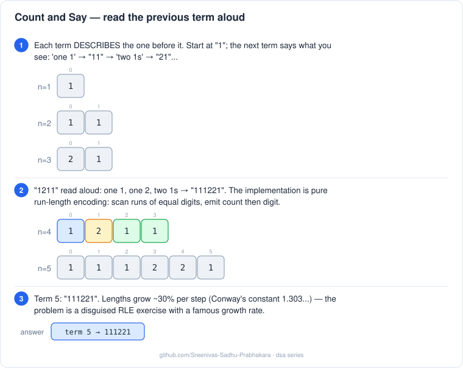

# Count and Say

> Striver SDE Sheet 102 · Day 16 String II — run-length encode the previous term, n−1 times; the inner loop is "find where this run ends". Go, stdlib only, tested.

## Problem

The look-and-say sequence starts at "1"; each term *reads the previous aloud*: "1" → "one 1" → "11" → "two 1s" → "21" → "one 2, one 1" → "1211"… Return the n-th term.

## Approach

Pure simulation — the task is run-length encoding applied n−1 times. The clean inner shape: for each run, advance a second index k while the character repeats, emit `(k−j)` then the character, jump j to k. No per-character state machine, no counters to reset — the run is a half-open interval and its length falls out of the indexes. `strings.Builder` keeps the n-fold string growth from going quadratic in allocations. (Fun fact worth the repo: term length grows ~30% per step — Conway proved the ratio converges to an algebraic number of degree 71.)

**Complexity:** O(total output length) — which itself grows exponentially in n.

## Visual walkthrough

Read the picture top to bottom — each numbered frame is one moment of the algorithm
running on this repo's test example.

## Run

    go test ./...   # verify
    go run .        # demo

---

One of 191 repos solving Striver's SDE Sheet in Go — stdlib only, one problem per repo, every solution tested. Browse the set: [`dsa-*` repos](https://github.com/Sreenivas-Sadhu-Prabhakara?tab=repositories&q=dsa-&type=source).
